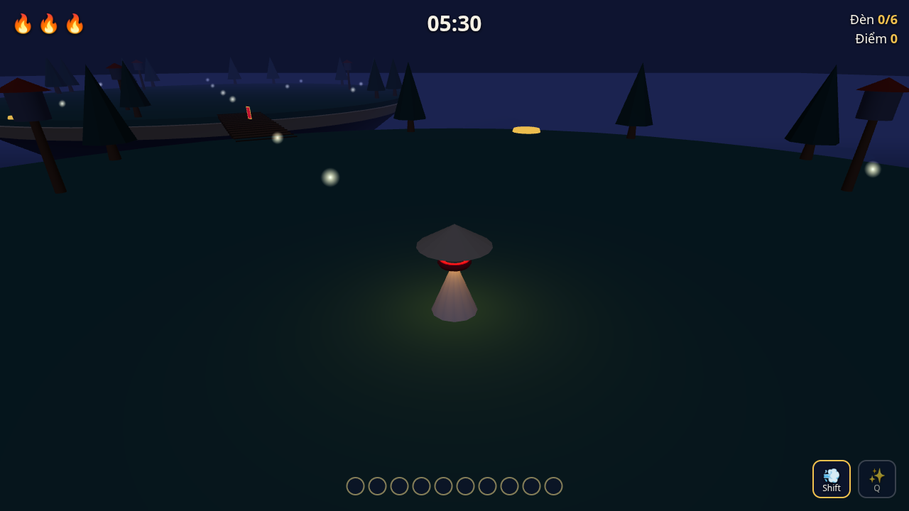

# Đảo Đèn Lồng

> 🎬 **Video demo:** [docs/demo/demo.mp4](docs/demo/demo.mp4) · 📦 **Bản phát hành:** [Release v1.0.0](../../releases/tag/v1.0.0) · Đề bài lab: [docs/lab/](docs/lab/README.md)

Game 3D góc nhìn thứ ba (Three.js, chạy trên trình duyệt). Mây, người giữ đèn nhỏ tuổi đội nón lá và quàng khăn đỏ, đi qua **3 Đêm**: Đảo Bến, Đảo Cau, Đảo Chuông. Ở mỗi đảo, Mây gom đom đóm để thắp và **giữ** các Đèn Lồng Lớn sáng tới bình minh, trong khi Bóng Mực tìm cách hút cạn dầu đèn và Gió Lạc rình cướp ánh sáng.



## Yêu cầu hệ thống
- macOS hoặc Linux (Windows chạy được qua trình duyệt, không có hỗ trợ chính thức).
- **Node.js ≥ 18** (đã thử với Node 24).
- Trình duyệt hỗ trợ WebGL2 (Chrome, Edge, Firefox, Safari bản mới). Có GPU thì tốt hơn. `bench` cần **Chrome hoặc Chromium**; nếu không ở đường dẫn chuẩn thì đặt `CHROME=/đường/dẫn`.
- Khoảng 20 MB ổ đĩa.

## Cài đặt & chạy (3 lệnh)

```bash
git clone <repo> && cd <repo>
npm install          # build_cmd (chỉ tải three.js)
node server.js       # run_cmd → mở http://localhost:5173   (hoặc: npm start)
```

Bản phát hành [v1.0.0](../../releases/tag/v1.0.0) có file `dao-den-long-v1.0.0-web.zip` chạy không cần `npm install`: giải nén rồi `node server.js`.

## Điều khiển (đổi được trong menu "Đổi phím")

| Phím mặc định | Hành động |
|---|---|
| W A S D | Di chuyển theo hướng camera |
| Kéo chuột / ← → | Xoay camera |
| Space | Nhảy |
| Shift | Lướt |
| E | Nạp ánh sáng / thắp lại / châm dầu cho đèn gần nhất |
| Q | Tỏa Sáng (3 đom đóm): làm choáng Bóng Mực trong 5 m |
| P hoặc Esc | Tạm dừng: Tiếp tục / Chơi lại Đêm / Cài đặt / Đổi phím / Về menu |

**Dễ tiếp cận** (Cài đặt, được lưu):
- Đổi phím mọi hành động; trùng phím thì báo và không nhận; có nút "Khôi phục mặc định".
- Phụ đề và chỉ báo hình ảnh: Bóng Mực xuất hiện kèm mũi tên ở mép màn hình, gió sắp thổi, 10 giây cuối, đèn sắp hết dầu.
- Giảm chuyển động: tắt rung camera và chớp màn hình.
- Chữ lớn ×1.25; chữ UI tối thiểu 18 px.
- Bảng màu dễ phân biệt cho người mù màu.

## Luật & cách tính điểm

- Nhặt đom đóm khi đi qua. **Sức chứa** bắt đầu 10, tăng 2 sau mỗi lần thắp thành công (tối đa 20).
- Thắp đèn lần đầu cần **10** đom đóm. Đèn sáng có **dầu** (100, hao 1/giây); bấm E để **châm dầu** (1 đom đóm = +10 dầu). Hết dầu thì đèn tắt; **thắp lại** cần 5 đom đóm.
- Đèn còn ≥ 30 dầu có vùng an toàn 6 m mà Bóng Mực không vào được. Đèn < 30 dầu nhấp nháy và bị Bóng Mực tới **hút dầu**.
- **Gió Lạc** (Đêm 2, 3) cướp đom đóm. **Bùa Gió** cho chạy nhanh và lướt không hồi chiêu. Rơi khỏi đảo thì mất 1 Ngọn Lửa.
- **Thắng**: còn sống khi bình minh tới (240 / 270 / 300 s) và có ≥ 60% số đèn đang sáng (3/5, 4/6, 5/7). **Thua**: hết 3 Ngọn Lửa, hoặc bình minh tới mà thiếu đèn sáng.

| Sự kiện | Điểm |
|---|---|
| Mỗi đom đóm nạp vào đèn (thắp, thắp lại, châm dầu) | +5 |
| Thắp lần đầu / thắp lại | +100 / +40 |
| Bóng Mực trúng Tỏa Sáng (đang hút dầu) | +5 (+15) |
| Bình minh (khi thắng): mỗi đèn đang sáng | +50 + floor(dầu) |
| Bình minh (khi thắng): mỗi Ngọn Lửa còn lại | +50 |

Tổng điểm là tổng các Đêm đã thắng. Sau màn Bình Minh hoặc khi thua, người chơi nhập tên để lưu vào **Bảng xếp hạng** (top 10, lưu ở `data/leaderboard.json`). Xuất bảng xếp hạng ra file:

```bash
node server.js --export-leaderboard out.json     # → {"entries": [...]} đúng thứ tự
```

## Test, headless, bench, soak (Test Contract v1.3)

```bash
npm test                                                             # 57 test: contract v1.0–v1.3, leaderboard, soak
node src/headless.js --seed 1 --night 1 --ticks 14400 --out out.jsonl [--scenario s.json] [--inputs i.json] [--snapshot-every 10]
node scripts/bench.mjs --seed 42 --duration 30 --out bench.json      # bench_cmd (mở cửa sổ Chrome 1280×720, vsync tắt)
node --expose-gc --jitless src/soak.js --seed 7 --nights 10 --out soak.json   # soak_cmd
bash scripts/proof.sh 3                                              # tạo lại bằng chứng headless
```

- **Bench**: mở một cửa sổ Chrome thật, viewport 1280×720, tắt vsync bằng `--disable-gpu-vsync --disable-frame-rate-limit`. Cảnh chuẩn: Đêm 1, 200 Bóng Mực đi lang thang, 100 đom đóm, L1–L3 sáng; camera bay vòng R 30 m, Y 15 m, 15 s một vòng. Đo thời gian khung hình bằng `requestAnimationFrame` sau 3 s khởi động. `peak_mem_mb` là tổng RSS của cả cây tiến trình Chrome (browser + GPU + renderer). Cá voi mây (phần sáng tạo) tắt trong bench. Muốn chạy không cửa sổ cho CI thì đặt `BENCH_HEADLESS=1` (số đo không đại diện).
- **Soak** chạy với `--jitless`: RSS khi bật JIT tăng khoảng 30 MB trong Đêm đầu do code TurboFan và allocator của các luồng compiler, rồi đứng yên, trong khi JS heap không đổi (4.1 → 4.5 MB). Soak đo độ ổn định chứ không đo tốc độ, nên tắt JIT để RSS phản ánh dữ liệu game. Phân tích ở [docs/proof/phase-4](docs/proof/phase-4/README.md).
- Kết quả trên máy dev (Core Ultra 7 155H, iGPU Intel Arc, Linux): [bench.json](bench.json) avg 205 FPS · p1-low 102.8 · load 2.9 s; [soak.json](soak.json) 0 crash, RAM 45.9 → 53.4 MB (×1.16).

## Sáng tạo của tôi
- **Cá voi mây**: những con cá voi khổng lồ bơi chậm trong biển mây. Chỉ có trong `web/main.js`, không có trong `sim.js`, và tắt trong bench.
- **Ông Đăng**: người giữ đèn già, có một câu dẫn chuyện riêng ở màn giới thiệu mỗi Đêm.
- **Chuông bình minh**: tháp chuông Đảo Chuông có quả chuông vàng; màn Bình Minh kể chuông ngân khi cả ba đảo sáng lại.
- Vòng sáng lan ra khi Tỏa Sáng và khi thắp đèn; lá bay báo trước gió; nhạc nền và mọi âm thanh tự tổng hợp bằng WebAudio.
- Bằng chứng phần lõi không bị ảnh hưởng: 57 test chạy CLI headless vốn không nạp `web/`.

## Kiến trúc
- `src/sim.js`: toàn bộ luật chơi, thuần và tất định (60 tick/s, không DOM, không `Math.random`). Thứ tự xử lý trong một tick theo đúng Ticket-02/03.
- `src/headless.js` (CLI contract), `src/soak.js`, `src/leaderboard.js`, `server.js` (static server + API bảng xếp hạng).
- `web/main.js` + `web/index.html`: render (Three.js), input, âm thanh, menu.
- `game.contract.json`: contract v1.3; `tuning` là nguồn số duy nhất.

## Tài liệu
- Bằng chứng: [phase-1](docs/proof/phase-1/README.md) · [phase-2](docs/proof/phase-2/README.md) · [phase-3](docs/proof/phase-3/README.md) · [phase-4](docs/proof/phase-4/README.md)
- Spec Phase 2: [spec-phase-2.md](docs/notes/spec-phase-2.md) · [ADR 0001](docs/adr/0001-lantern-fuel-and-dawn-win.md) · [CHANGELOG.md](CHANGELOG.md)
- Giả định: [assumptions.md](docs/notes/assumptions.md) · Nhật ký AI: [ai-log.md](docs/notes/ai-log.md) · Retro: [retro.md](docs/notes/retro.md)
- Harness AI: [AGENTS.md](AGENTS.md), [CLAUDE.md](CLAUDE.md), [.claude/settings.json](.claude/settings.json) (hook Stop chặn kết thúc khi test đỏ), [.claude/skills/verify](.claude/skills/verify/SKILL.md)
- [CREDITS.md](CREDITS.md) · [LICENSE](LICENSE) (MIT)
