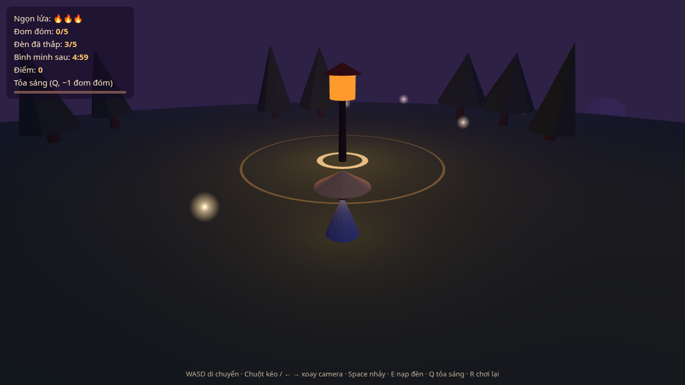

# Đảo Đèn Lồng

> 🎬 **Video demo:** _(thêm ở Phase 4 — Release `v1.0.0`)_ · Đề bài lab: [docs/lab/](docs/lab/README.md)

Game 3D góc nhìn thứ ba (Three.js, chạy trên trình duyệt). Mây, người giữ đèn nhỏ tuổi đội nón lá, gom đom đóm khắp Đảo Bến để thắp lại 5 Đèn Lồng Lớn trước bình minh, né những Bóng Mực trong sương đen.



## Cài đặt & chạy (macOS / Linux, Node ≥ 18)

```bash
npm install          # build_cmd
npm start            # run_cmd → mở http://localhost:5173
```

Headless (Test Contract v1.0):

```bash
node src/headless.js --seed 1 --night 1 --ticks 3600 --out out.jsonl \
  [--scenario s.json] [--inputs i.json] [--snapshot-every 10]
```

Test & bằng chứng: `npm test` · `bash scripts/proof.sh`

## Điều khiển

| Phím | Hành động |
|---|---|
| W A S D / ↑ ↓ | Di chuyển (theo hướng camera) |
| Kéo chuột / ← → | Xoay camera |
| Space | Nhảy |
| E | Nạp đom đóm vào đèn gần nhất (trong 3 m) |
| Q | Tỏa sáng: tốn 1 đom đóm, làm choáng + đẩy lùi Bóng Mực trong 6 m |
| R / Enter | Chơi lại (sau thắng/thua) |

## Luật & cách tính điểm

- Nhặt đom đóm khi đi qua (≤ 1.5 m), mang tối đa **5**. Mỗi đèn cần **5** đom đóm; nạp được từng phần.
- Bóng Mực đuổi theo (3.5 m/s, chậm hơn Mây 6 m/s). Chạm (≤ 1 m) → mất **1 ngọn lửa** (có 3), rơi mất **50%** đom đóm đang mang (làm tròn xuống), bất tử 1.5 s.
- Tỏa sáng: choáng 3 s, đẩy lùi 4 m, hồi chiêu 2 s. Không đủ đom đóm thì không tỏa sáng được.
- **Đèn đã thắp** tạo vùng an toàn bán kính 5 m: Bóng Mực không vào được.
- Bóng Mực mới xuất hiện mỗi 30 s (tối đa 6). Đom đóm tự sinh lại mỗi 4 s (giữ tối đa 20 con).
- **Thắng:** thắp đủ 5 đèn. **Thua:** hết ngọn lửa, hoặc hết 300 s (bình minh tới khi đảo còn tối).

| Sự kiện | Điểm |
|---|---|
| Nhặt 1 đom đóm | +10 |
| Thắp 1 đèn | +100 |
| Mỗi Bóng Mực bị choáng bởi tỏa sáng | +20 |
| Khi thắng: mỗi giây còn lại (làm tròn xuống) | +2 |
| Khi thắng: mỗi ngọn lửa còn lại | +50 |

Ví dụ kiểm chứng: kịch bản `win` → 5×10 + 100 + 2×118 + 3×50 = **536** (khớp output headless).

## Test Contract

- `game.contract.json` — `tuning` là **nguồn số duy nhất**: `src/sim.js` đọc trực tiếp các số này (cả bản chơi lẫn headless), nên khai báo luôn khớp với game.
- `fall_enabled: false`: mép đảo là tường mềm, không rơi được → không bao giờ phát `player_hit` với `by: "fall"`. Không có trường nào là `null`.
- Số không có chỗ trong contract (bán kính đảo 40 m, nhảy, nhịp sinh quái…) nằm ở `EXTRA` trong `src/sim.js`.
- Trạng thái Bóng Mực: `chase` | `stunned`. Snapshot có thêm mảng `motes` (id, pos) theo khuyến nghị.
- Mã thoát: 0 thành công; 2 file scenario/inputs sai định dạng (JSON hỏng, tick không tăng nghiêm ngặt, sai kiểu, id đèn lạ); 1 lỗi tham số khác.

## Sáng tạo của tôi

- **Cá voi mây**: 3 con cá voi khổng lồ bơi chậm quanh biển mây bên dưới đảo — chỉ là hình ảnh trong `web/main.js`, không tồn tại trong `sim.js`, nên **không ảnh hưởng headless**.
- **Đảo sáng dần**: sương tan và trời chuyển tím-hồng theo số đèn đã thắp; đèn đã thắp vẽ vòng vùng an toàn; vòng tiến độ nạp quanh chân đèn.
- **Âm thanh tự tổng hợp** (WebAudio) cho nhặt, nạp, thắp đèn, tỏa sáng, bị chạm, thắng/thua.
- Bằng chứng phần lõi vẫn đúng: toàn bộ test contract (`npm test`, 24/24) chạy trực tiếp CLI headless vốn không nạp `web/`; xem [docs/proof/phase-1](docs/proof/phase-1/README.md).

## Tài liệu

- Bằng chứng: [docs/proof/phase-1/](docs/proof/phase-1/README.md)
- Giả định: [docs/notes/assumptions.md](docs/notes/assumptions.md) · Nhật ký AI: [docs/notes/ai-log.md](docs/notes/ai-log.md)
- Harness AI: [AGENTS.md](AGENTS.md), [CLAUDE.md](CLAUDE.md), [.claude/settings.json](.claude/settings.json) (hook Stop chặn kết thúc khi test đỏ), [.claude/skills/verify](.claude/skills/verify/SKILL.md)
- [CREDITS.md](CREDITS.md) · [LICENSE](LICENSE) (MIT)
